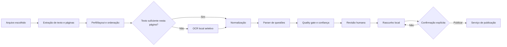
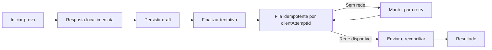

# Fluxos Propostos (alvo de produto — os medidos estão em [[Fluxos Reais]])

Os diagramas abaixo resumem os fluxos-alvo do Plano Mestre e das diretrizes do
produto. As fronteiras exatas, dados transferidos e estados de falha **foram
confirmados em 2026-11-05** em [[Fluxos Reais]]; onde os dois divergirem,
[[Fluxos Reais]] descreve o código e esta nota descreve a intenção.

## Importação

## Tentativa e sincronização

## Publicação e consumo

Antes de transformar qualquer fluxo em ADR de arquitetura, verificar contratos
atuais, transições, idempotência e falhas. [[../09 - Auditoria/Áreas/Mapa das Áreas|Auditoria profunda]].
